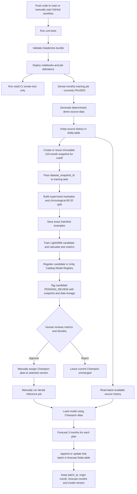

# Dental forecasting MLOps — simple end-to-end guide

This document describes what the dental demo currently does, what happens when
you deploy it, how a model version is connected to its training and test data,
and what still needs to happen before using real claims data.

> **Important:** The current generator creates synthetic demo data. It is not
> genuine dental claims data and must not be used for business decisions.

## The whole flow at a glance



## What files do what?

| File | In simple terms |
|---|---|
| `src/dental/dental_forecasting_utils.py` | Shared helper logic: synthetic data generation, monthly PMPM calculations, snapshot cutoff/window checks, supervised examples, time-ordered split, and future forecast features. |
| `src/dental/dental_generate_synthetic_data.py` | First training-job notebook. Generates demo source rows, merges them into the source table, creates/reuses that cutoff's 120-month snapshot, verifies it, and passes its snapshot ID to the next task. |
| `src/dental/dental_train_forecast.py` | Reads only the snapshot ID passed by the generator; creates features/targets; splits chronologically 80:20; saves the split examples; trains and evaluates candidate models; logs lineage to MLflow; registers a candidate, but does not approve it. |
| `src/dental/dental_inference_forecast.py` | Loads the registered model whose alias is `Champion`, reads the source table, prepares the latest three forecast horizons, and saves predictions and batch/model metadata. |
| `resources/dental/training_job.yml` | Defines one Databricks job with two ordered tasks: generator first, trainer second. It is scheduled monthly but its schedule is currently `PAUSED`. |
| `resources/dental/inference_job.yml` | Defines a separate manual inference job. It has no monthly schedule configured. |
| `tests/test_dental_forecasting.py` | Local unit tests for synthetic data, cutoff/window rules, PMPM calculations, chronological split, and three-month future features. These tests do not connect to Databricks or prove workspace permissions. |
| `.github/workflows/deploy.yaml` | On a push to `main` (or manual workflow start), tests and deploys the bundle, then runs the **retail** CI smoke-test job. It does not run dental training or dental inference. |
| `databricks.yml` | Tells Databricks Bundles which resource YAMLs and source files to deploy and where the bundle state is stored. |

`dental_forecasting_utils.py` is included into the dental notebooks with Databricks
`%run`, so the notebooks can use its functions and constants.

## What data does the demo use?

Today, it does **not** read a genuine claims feed, uploaded CSV, or a production
database. The generator creates deterministic synthetic monthly data for six
demo plans. Each monthly row includes:

- `plan_id`
- `event_month`
- `member_months`
- `claim_count`
- `total_claim_amount`
- `dataset_version`

The training utilities calculate:

- `claims_frequency_pmpm = claim_count / member_months`
- `claims_cost_pmpm = total_claim_amount / member_months`

`PMPM` means “per member per month.” These are the two values the model learns
to forecast.

## Monthly training: dates, rolling window, snapshots

The training job is configured for 05:00 India time on the first day of each
month. When run, the generator uses the job's start timestamp and chooses the
last complete India-time calendar month as its cutoff. For example:

| Job run | Cutoff | Snapshot ID | Snapshot window |
|---|---|---|---|
| 1 November 2026, 05:00 IST | October 2026 | `dental-claims-2026-10` | November 2016–October 2026 |
| 1 December 2026, 05:00 IST | November 2026 | `dental-claims-2026-11` | December 2016–November 2026 |

Each later window moves forward by one month and still contains 120 months.
The source Delta table keeps its existing rows; the generator uses a merge keyed
by `plan_id` and `event_month`, so rerunning the demo generator updates matching
source rows and inserts missing months.

The immutable snapshot table is:

```text
dental_forecasting.training_data.plan_monthly_snapshots
```

Its stable `dataset_snapshot_id` identifies a cutoff's saved monthly input.
Existing snapshot rows are inserted only when missing; a retry for the same
cutoff does not overwrite that snapshot. The table also stores the cutoff,
`source_type` (currently `synthetic_demo`), and snapshot creation timestamp.

The generator publishes the ID as a Databricks task value. The training task
receives that exact ID through the job YAML; it does not guess which snapshot
to train on.

### Find the monthly raw snapshot

```sql
SELECT *
FROM dental_forecasting.training_data.plan_monthly_snapshots
WHERE dataset_snapshot_id = 'dental-claims-2026-10'
ORDER BY plan_id, event_month;
```

## How is the 80:20 train/test split made?

The training notebook reads the selected snapshot and turns history into
supervised examples. One example says, in effect: “using the history available
at this origin month, predict this plan's result at forecast horizon 1, 2, or 3.”
Features include plan, horizon, seasonal month indicators, and previous 1-, 2-,
3-, and 12-month PMPM values. Targets are frequency PMPM and cost PMPM.

The code sorts the examples' **target months**. The first 80% of distinct
target-month periods are training; the latest 20% are test. This is a
chronological/time-based split—not a random shuffle. Because the boundary is
by month, the split is not necessarily exactly 80% of individual rows.

The exact examples and split label are saved in:

```text
dental_forecasting.training_data.supervised_examples
```

To inspect the test examples for a cutoff:

```sql
SELECT *
FROM dental_forecasting.training_data.supervised_examples
WHERE dataset_snapshot_id = 'dental-claims-2026-10'
  AND split = 'test'
ORDER BY target_month, plan_id, forecast_horizon;
```

To inspect the training examples instead, change `split = 'test'` to
`split = 'train'`.

The notebook trains a multi-output LightGBM model and calculates MAE metrics
for both targets and each forecast horizon. It also calculates a Statsmodels
Holt-Winters baseline for comparison. These metrics help a person decide
whether the candidate is suitable; the notebook does not automatically make
that decision.

## How is the data connected to a model version?

The trainer logs parameters, metrics, and tags in the Databricks MLflow
experiment `/Shared/dental-claims-forecasting`, then registers the LightGBM
candidate under this Unity Catalog model name:

```text
dental_forecasting.models.dental_claims_forecast
```

The registered model version is tagged with the snapshot ID, cutoff month,
source type, training window, and train/test target-month boundaries. The
corresponding supervised examples table holds the rows for those train and test
periods. This is how you can connect a model version to the data it used.

For a version, first read its `dataset_snapshot_id` and date tags in the
Databricks Model Registry. Then use that ID in the SQL queries above.

Example:

```text
Model version 8
  -> dataset_snapshot_id = dental-claims-2026-10
  -> cutoff_month = 2026-10
  -> snapshot rows = plan_monthly_snapshots filtered by that ID
  -> exact test rows = supervised_examples filtered by that ID and split='test'
```

The version number in this example is illustrative. Actual model version
numbers are assigned by the registry when a real training run succeeds.

## Manual approval, Champion, and rollback

Training tags every new registered model version as
`approval_status = PENDING_REVIEW`. **There is no code in this repo that
automatically approves a candidate or assigns the `Champion` alias.**

After reviewing metrics and lineage:

1. Open Databricks **Catalog** and find
   `dental_forecasting.models.dental_claims_forecast`.
2. Open the candidate version and inspect its run, metrics, and lineage tags.
3. If approved, manually assign the model alias `Champion` to that version.
   The exact UI controls can vary by workspace version and permissions.
4. If not approved, do not move the alias. Inference will continue to use
   whichever version is already `Champion`.

Rollback means manually moving `Champion` back to a previously approved
registered version. Future inference runs will then load that older version.
Already-written forecast rows remain in the output table and record which model
version produced them; rollback does not erase or recalculate those rows.

If no model version has `Champion`, the inference job fails clearly when it
tries to resolve the alias.

## Inference: input, model, and output

The inference job is separate from training and currently has **no schedule**.
It must be run manually. When it runs:

1. It resolves `Champion` from the dental model registry and loads that model.
2. It reads `dental_forecasting.source.plan_monthly_claims`.
3. It builds lag features from each plan's latest available history and makes
   forecasts for horizons 1, 2, and 3.
4. It checks prediction shape and rejects non-finite output.
5. It writes one row per plan and forecast month to:

   ```text
   dental_forecasting.predictions.plan_claims_forecast
   ```

The result includes plan, origin month, forecast month, horizon, predicted
frequency PMPM, predicted cost PMPM, model name/version, `batch_id`, and run
timestamp. With six demo plans and three horizons, a run currently produces 18
forecast rows.

Each run gets a new batch ID by default. Rows are merged by batch, plan, and
forecast month, so rerunning the same batch is idempotent and a new batch
preserves previous batches.

Example: list batches and the model versions used:

```sql
SELECT batch_id, origin_month, model_version, forecast_run_timestamp,
       COUNT(*) AS forecast_rows
FROM dental_forecasting.predictions.plan_claims_forecast
GROUP BY batch_id, origin_month, model_version, forecast_run_timestamp
ORDER BY forecast_run_timestamp DESC;
```

## What deploy does—and does not do

The GitHub workflow deploys definitions and notebooks. It does **not** mean
that the dental model has been trained or approved.

- Push to `main` or manually start the workflow.
- GitHub Actions installs test dependencies and runs `pytest tests/`.
- Databricks CLI validates and deploys the bundle.
- The later `ci_smoke_test` command runs the retail smoke-test job only.
- Dental training is a Databricks job with a monthly schedule configured but
  currently paused. Deploying does not unpause or execute it.
- Dental inference is a separate manual Databricks job and is not run by the
  GitHub workflow.

## First-run prerequisites

Before the first Databricks dental training run, an administrator must create
the Unity Catalog `dental_forecasting` catalog if it does not already exist,
and give the job's Run as identity the required catalog, schema, table, model,
and experiment permissions. The generator creates schemas inside the catalog,
but it cannot create the catalog itself.

The local checks (`pytest` and `databricks bundle validate`) do not create
catalogs, run notebooks, deploy jobs, approve models, or verify workspace
permissions.

## What is still needed for genuine production data?

Replace the synthetic generator with an ingestion notebook/pipeline that reads
an agreed real source (for example, controlled file delivery, database, or
claims platform), validates its schema and monthly completeness, and writes
the same documented raw columns to a controlled source table. Keep the
synthetic source clearly separated from real data; never silently mix them.

Then test one monthly cutoff end to end, verify the snapshot and test rows,
review and approve a candidate, assign `Champion`, and run inference. Only
after access, data quality, model quality, monitoring, and rollback are
verified should the monthly training schedule be unpaused and an inference
schedule/trigger be decided.